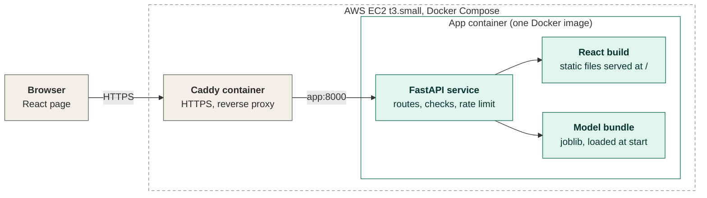
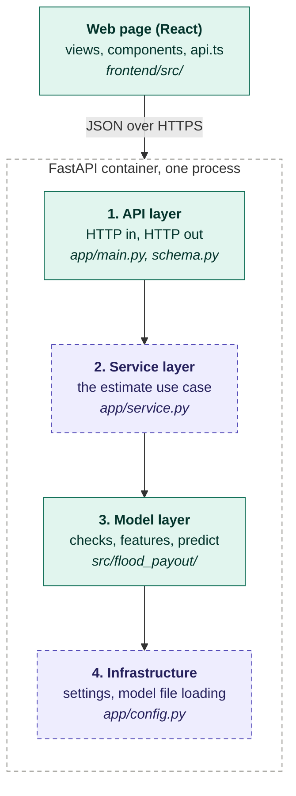

# Tech Stack: Flood Payout Calculator

Last updated: 7 November 2026
Status: the local MVP runs (FastAPI service and React page), including under Docker Compose with Caddy. The AWS deployment and the deploy workflow are not built yet. To run the MVP on your computer, go to section 10.

## 1. Summary

The calculator is one web application. A Python backend loads the trained model and serves both the API and the web page. The page is built with React. Everything runs in one Docker container on one AWS EC2 server in Sydney, behind Caddy for HTTPS.

## 2. Architecture

The calculator is a **layered monolith**. "Monolith" describes how it is deployed: one service, one process, one Docker image. "Layered" describes how the code inside is organised: layers that depend on each other in one direction only, so each kind of bug has one place to look.

### Runtime view



Grey boxes are infrastructure. Green boxes are our code.

- Caddy is the only part the internet can reach (ports 80 and 443). The app container is reachable from Caddy alone.
- One FastAPI process serves the page, the API and the model. The model file is read once at start.
- There is no database, and no personal data is stored.
- The container runs one worker on purpose, because the rate limit counts requests in memory (see "Seams for later").

### Code layers



Green boxes exist today. Purple dashed boxes are new files planned for the final.

| Layer | Job | Files | Status |
|---|---|---|---|
| 1. API | Turns HTTP into calls and results into HTTP: routes, the shape of the request (Pydantic), the rate limit, errors to status codes, serving the page | `app/main.py`, `app/schema.py` | Exists. Will shrink to routing only |
| 2. Service | The "estimate a payout" use case: takes the checked request, calls the model layer, builds the answer, keeps the request counters and logs | `app/service.py` | New for the final. Today this code sits inside `main.py` |
| 3. Model | Business checks (`validate`), features, prediction, the model bundle format. No web code | `src/flood_payout/` | Exists |
| 4. Infrastructure | Settings from environment variables (`RATE_LIMIT`, `MODEL_PATH`, `STATIC_DIR`) in one place, and loading the model file at start | `app/config.py` | New for the final. Today settings are read in `main.py` and `model.py`, and the model loads when `model.py` is imported |

Rules that make the layers useful:

1. Dependencies point down only. A layer may use the layers below it and never the ones above. The model layer knows nothing about FastAPI, and the API layer does not import scikit-learn or pandas.
2. One allowed shortcut: `schema.py` reads the field lists from the model layer, so the form checks and the model's own checks cannot drift apart.
3. The page follows a similar rule. Screens in `views/` and `components/` never call the service themselves. `api.ts` is the only file that does.

Where to look when something is wrong:

| Symptom | Layer | Look in |
|---|---|---|
| The amount or range is wrong | Model | `src/flood_payout/`, `models/` |
| Wrong error message or status code, or the page is not served | API | `app/main.py`, `app/schema.py` |
| The response is built wrong, or counters and logs are off | Service | `app/service.py` (today `app/main.py`) |
| A setting is ignored, the wrong model loads, a wrong port or certificate | Infrastructure | `app/config.py`, `Caddyfile`, `docker-compose.yml` |
| A screen looks or reads wrong | Page | `frontend/src/views/`, `frontend/src/components/` |

Seams for later. The service stays one unit for now. These are the places where it would split if a real need appears:

- **Rate limit.** It counts requests in memory, so the container runs one worker (`--workers 1`). More workers or servers need a shared store, or the limit moves to the gateway.
- **Model release.** The model file ships inside the image, so a retrain means a rebuild and a redeploy. `MODEL_PATH` already allows loading it from elsewhere (a volume or S3). That would let us retrain without rebuilding.
- **The page.** Vite builds static files, so the page could move to S3 and CloudFront (or Vercel). The cost is CORS settings, a second deploy and a chance of page and API being on different versions.

### Plan for the final

Each step ends with all tests passing.

1. Done on 7 November 2026: the API tests are in `tests/test_api.py`, so HTTP behaviour is locked before anything moves.
2. Add `app/config.py` and read all settings from it.
3. Add `app/service.py`. Move the estimate logic and counters out of `main.py`, so the routes only translate HTTP.
4. Load the model at start and keep it on `app.state`, so tests can use a fake model.
5. Optional: split `src/flood_payout/bundle.py` into prediction and training code. Ahmad's tests import it as `B`, so `bundle.py` stays as a thin re-export.

## 3. Stack by layer

| Layer | Technology | Purpose | Notes |
|---|---|---|---|
| Model | Python, scikit-learn 1.9.1, joblib, NumPy | Per path (with or without water depth): 25th, 50th and 75th percentile gradient-boosting models plus a payout-band classifier (gives the chance of $0); calibrated ranges | scikit-learn must match the version that saved the model, or it may not load |
| Data handling | pandas | Shapes the form into model input (the model takes a DataFrame) | Needed in the request path |
| Backend API | FastAPI, Pydantic v2, uvicorn | Endpoints `/`, `/api/estimate`, `/health`; input validation | Pydantic `extra="forbid"` rejects unknown fields, so no adjuster-only `post_` column reaches the model. FastAPI also gives automatic API docs at `/docs` |
| Rate limiting | slowapi | Per-IP limit on `/api/estimate` (default 30 per minute, set with `RATE_LIMIT`) | Uses the `X-Forwarded-For` header that Caddy sets |
| Frontend | React, Vite, Tailwind CSS | Input form, result page with range bar, "How it works" page | Vite builds static files. The range bar is custom, so no chart library is needed |
| Design reference | Figma | Screen layouts, colours and type (Inter) | Design tool only. Not part of the running app |
| Testing (backend) | pytest, httpx, ruff | Ahmad's 11 tests (leakage guard, input validation, answer checks, regression on six example houses), 47 API test cases (status codes, rate limit, response fields, allowed ranges, serving the page, model version), lint | Runs on pull requests |
| Testing (frontend) | Vitest, React Testing Library | Form validation and the form-to-result flow | Runs on pull requests |
| Packaging | Docker (multi-stage build), Docker Compose | One image per model version. Stage 1 builds the React app; stage 2 is the Python runtime | Compose runs the app and Caddy together |
| Reverse proxy | Caddy | HTTPS, with certificates issued and renewed automatically | HTTP only until a domain points at the server |
| Hosting | AWS EC2, t3.small, Ubuntu LTS, Elastic IP, region ap-southeast-2 (Sydney) | Runs the containers | The new AWS free-plan account covers the prototype: the $100 credit arrived on 7 November 2026. The free plan fixes the region to Sydney (section 8) |
| Registry | GitHub Container Registry (GHCR) | Stores tagged images | No extra AWS account or keys needed to push |
| Source control | GitHub (private repository) | Code, pull requests, workflows | Keep the repository private |
| CI | GitHub Actions on GitHub-hosted runners | Checks on every pull request | Lint, tests, leakage check, regression check, build without push |
| CD | GitHub Actions with a self-hosted runner on the EC2 server | Deploys when someone starts the deploy workflow by hand from `main` | Smoke test; the last good tag is restored automatically on failure. Manual rollback workflow. (Approval gates on environments are not available on private repositories on the free plan) |
| Monitoring | Daily health check from GitHub Actions, CloudWatch CPU alarm, AWS Budgets alert and billing alarm | Detects outages and unexpected cost | Set up before the first deploy |
| Upgrade path (later) | AWS Lambda with Lambda Web Adapter, API Gateway, ECR, S3 and CloudFront, GitHub OIDC | Serverless hosting when the server is idle or traffic is spiky | Same Docker image; not started in this phase |

## 4. Why these choices

- **Monolith, organised in layers.** One FastAPI service serves the API, the model and the React build. It is the simplest option for one model and one server, and it is easy to deploy and debug. Layers (section 2) keep the code easy to fix, because each kind of bug has one home. Splitting into several services would add work without a benefit at this size.
- **Iterative development.** Work runs in thin slices, and each slice ends with something that runs or is deployed. Waterfall was not chosen because the model and UI may change after results come in.
- **React with Vite.** The team knows React from MERN work. Vite produces plain static files, which can move to S3 and CloudFront later. A plain HTML page with Tailwind is the fallback if time runs short.
- **EC2 with Docker Compose, not Lambda, for now.** One server is easier to debug while the team learns AWS. Lambda is the upgrade path.
- **GHCR, not ECR, for now.** GitHub Actions can push there without AWS keys. ECR is used after the Lambda move.
- **Self-hosted runner on the server.** Deploys need no inbound SSH from GitHub. The risk is that the runner must not run untrusted code: keep the repository private and run deploy jobs from `main` only.

## 5. Repository layout

```
app/                  FastAPI service: main.py (routes, rate limit), schema.py (Pydantic), model.py (loads the bundle)
src/flood_payout/     shared model code: bundle.py (validation, prediction), features.py (form fields,
                      leakage rules), final_config.py, models.py, evaluation.py
models/               flood_payout_v2.joblib (model bundle) and MODEL_CARD.md
frontend/             React + Vite + Tailwind source (npm run build writes frontend/dist)
tests/                pytest: service tests (leakage guard, validation, answers, regression) and API tests (HTTP)
retrain.py            seasonal retraining; promotes a new bundle only if it is not worse
requirements.txt      pinned Python packages (production)
requirements-dev.txt  adds pytest, httpx, ruff
pyproject.toml        ruff and pytest settings
Dockerfile            multi-stage: builds the React app, then the Python runtime image
docker-compose.yml    app + Caddy together
Caddyfile             HTTPS and reverse proxy
.env.example          DOMAIN setting (copy to .env)
.python-version       Python 3.13 (Node 22 is in frontend/.nvmrc)
.github/workflows/    ci.yml (pull request checks); deploy workflow comes later
```

## 6. Version pinning

- Python packages: exact versions in `requirements.txt`, the ones the model file was built with (scikit-learn 1.9.1). A joblib model must be loaded with the same scikit-learn version that saved it.
- Frontend packages: `package-lock.json` committed.
- Python and Node versions: `.python-version` and `frontend/.nvmrc`.
- Docker base images: pinned by tag, not `latest`.

## 7. Out of scope for the prototype

- Domain name (added later; Caddy then issues HTTPS).
- User accounts, login and saved estimates.
- Database. The application stores no personal data.
- Retraining pipeline (planned for once per flood season, as a separate workflow).

## 8. Open decisions

- **AWS account (done):** the TA confirmed the course provides no AWS account, so we opened a new account on the free plan. The $100 sign-up credit arrived on 7 November 2026, and setting a budget earned a further $20. The free plan lasts 6 months or until the credits run out. A new account's default project is pinned to one region based on the contact address, and ours is Asia Pacific (Sydney), `ap-southeast-2`. Using Singapore would need an upgrade to the paid plan and advanced features, which risks real charges, so we stay in Sydney. The extra distance does not matter for a demo.
- **Backup host if AWS does not work out (open):** Render, with Vercel for the page as an option. Both have free plans and the team already knows them (details in section 9). DigitalOcean or Azure also stay possible: DigitalOcean's GitHub Student Pack credit ended on 31 July 2026, so a 2 GiB Droplet would cost about $12 per month unless a new-user offer applies, and for Azure we would check what the current Azure for Students offer gives with a school email. Decide only if the AWS credit does not arrive.
- Settled for the MVP: FastAPI with Pydantic, React with Vite, scikit-learn 1.9.1 and Python 3.13 (the versions the model was built with), and `pandas` in the request path.

## 9. Fallback and backup plan

- **Fallback if EC2 cannot be paid for:** AWS Lambda, running the same Docker image through Lambda Web Adapter, API Gateway, ECR, S3 and CloudFront. It costs less at low traffic, and AWS's always-free allowance may cover a demo. The first request after a quiet period is slower, because the model loads again. This is described for the report only, to show the option was considered. We will not build or test it.
- **Free-host fallback: Render, with Vercel for the page as an option.** Render runs the same Docker image as a web service. It provides HTTPS itself, so Caddy is not needed there. Make sure Render uses port 8000, the port the Dockerfile exposes.
  - Limits of Render's free web service (from Render's documentation): 512 MB of RAM and 0.1 CPU; it sleeps after 15 minutes without traffic and takes about a minute to wake; 750 free instance hours per month; no persistent disk (the app needs none). Render's documentation says not to use free services for production applications, so this is a fallback for the demo, not the main plan.
  - Memory fits. On 7 November 2026, under Docker on a Mac, the app container used about 158 MiB after several estimates (Caddy used about 64 MiB more, which Render does not need). Still to check on Render itself: how long start-up and the first answer take on 0.1 CPU.
  - Vercel's Hobby plan is free for personal, non-commercial use only, which fits a course project. It would host the built page, with a `vercel.json` rewrite sending `/api/*` to the Render address. The page then opens instantly, and only the first estimate waits while Render wakes. The cost is a second deploy and one more setting to test.
  - Use Render alone first, because it has the fewest parts. Add Vercel only if the wake-up delay is a problem. Before a demo, open the page a few minutes early so the service is awake.
- **Backup server (school server, ml_brain lab),** if the lab confirms all of the following:
  - it is reachable from the internet on ports 80 and 443
  - Docker can be installed, with root or sudo access
  - hosting a public web app is allowed
  - it stays up through the demo
  - it has enough CPU, memory and uptime for the app

  The same image and DuckDNS subdomain work there too.

## 10. Run the app locally

No AWS account is needed. Run every command from the repository root unless a step says otherwise. There are two ways: Option A needs Python and Node on your computer, Option B needs only Docker Desktop.

### Before you start (Option A)

Check your versions:

```
python3.13 --version     # Python 3.13.x
node --version           # v22.x
```

Python 3.13 and Node 22 are pinned in `.python-version` and `frontend/.nvmrc`. With an older Node (for example v20), `npm ci` stops with "Unsupported engine". Install Node 22 with nvm and open a new terminal:

```
nvm install 22
nvm use 22
```

### Option A: on your computer

**1. Python environment (once).**

```
python3.13 -m venv .venv
source .venv/bin/activate        # Windows: .venv\Scripts\activate
pip install -r requirements-dev.txt
```

**2. Check the back end.** Expect `All checks passed!` and `58 passed`.

```
ruff check .
pytest
```

**3. Build the page** (once, and again after you change the front end). Expect `15 passed` from the tests.

```
cd frontend
npm ci
npm test
npm run build                    # writes frontend/dist
cd ..
```

**4. Start the service.**

```
uvicorn app.main:app --port 8000
```

**5. Use it.** Open http://localhost:8000, choose "Start estimate", answer the ten questions and read the result. Stop the service with Ctrl+C.

The service serves the page at `/`, the estimate endpoint `POST /api/estimate`, a health check at `/health` and API docs at `/docs`. To try the API without the page, in a second terminal:

```
curl http://localhost:8000/health
curl -X POST http://localhost:8000/api/estimate -H "Content-Type: application/json" \
  -d '{"flood_zone":"A","year_built":1985,"floors":"1","foundation":"slab","basement":"none","elevated":false,"primary_residence":true,"coverage_building":250000,"deductible_building":1250,"water_depth_inches":12}'
```

This example house returns a low of 38,600, a middle of 88,500 and a high of 138,600, with a coverage limit of 250,000.

**While editing the page.** Keep the service running (step 4). In a second terminal run `cd frontend && npm run dev` and open the address it prints (usually http://localhost:5173). It forwards `/api` and `/health` to the service on port 8000, and your changes show up without a rebuild.

### Option B: Docker Desktop

Start Docker Desktop, then:

```
docker compose up --build
```

The first build downloads the base images and packages, so it takes a while. Open http://localhost. Caddy serves plain HTTP on port 80 while `DOMAIN` is unset. The build compiles the React page and fails if the model file does not load with the pinned library versions. Stop with Ctrl+C, then run `docker compose down`.

### Settings (optional)

| Setting | Default | What it does |
|---|---|---|
| `RATE_LIMIT` | `30/minute` | Requests allowed per client address. Example: `RATE_LIMIT=300/minute uvicorn app.main:app --port 8000` |
| `MODEL_PATH` | `models/flood_payout_v2.joblib` | Model bundle to load |
| `STATIC_DIR` | `frontend/dist` | Folder with the built page (the Docker image sets `/srv/static`) |
| `DOMAIN` | `:80` | Name Caddy serves, set in `.env` for Docker (see `.env.example`) |

### If something goes wrong

| What you see | What to do |
|---|---|
| `Unsupported engine` or `Cannot find native binding` during `npm ci` or `npm test` | Node is older than 22. Run `nvm install 22`, open a new terminal, run `rm -rf frontend/node_modules`, then `npm ci` again. Do not delete `package-lock.json`. |
| http://localhost:8000 shows a short JSON message pointing to `/docs` instead of the page | The page is not built. Run step 3. |
| `Address already in use` | Another program uses the port. Start with `--port 8001` and open that port instead. |
| "Too many requests" in the page | The limit is 30 requests per minute per address. Wait a minute, or raise `RATE_LIMIT`. |
| `ModuleNotFoundError: No module named 'app'` | You are not in the repository root, or the virtual environment is not active. |
| Docker: "Cannot connect to the Docker daemon" | Start Docker Desktop and run the command again. |
| Docker: port 80 or 443 is already allocated | Stop the program that uses it, or change the `ports` entries in `docker-compose.yml`. |

The claims data is not in this repository. `retrain.py` needs it as input (`--table`), so retraining runs where the data is.

## 11. Tests

There are 73 automated test cases: 58 for the service (11 service tests and 47 API cases) and 15 for the web page. GitHub Actions runs all of them on every pull request and every push to `main`. To run them yourself, follow the steps in section 10: `pytest` for the service and `cd frontend && npm test` for the page.

### Service tests (11, `tests/test_service.py`)

| Group | Test | What it checks |
|---|---|---|
| Leakage guard | `test_adjuster_fields_rejected` | Fields that only exist after an adjuster visits (`post_damage_building`, `paid_building`, `post_building_value`, `damage_estimate`, `id`) are refused as model inputs. |
| Leakage guard | `test_bundle_uses_only_allowed_inputs` | The saved model, with and without flood depth, uses only the allowed inputs. |
| Validation | `test_missing_required` | A missing required answer (`coverage_building`) gives an error that names the field. |
| Validation | `test_bad_values` | Rejects an unknown state, coverage of $900,000, negative depth, floors "seven", a year built of 1700 and elevated "maybe". |
| Validation | `test_unknown_field_rejected` | An extra field such as `building_damage` is refused. |
| Validation | `test_optional_fields_default` | Optional answers left out fall back to defaults (foundation "unknown", no depth). |
| Answers | `test_range_is_ordered_and_capped` | For depths of 0 to 48 inches and unknown, and coverage of $50,000 to $250,000: low is at least 0, low <= middle <= high, high does not exceed the coverage limit, the payout-band shares add up to 1, and the chance of $0 is between 0 and 1. |
| Answers | `test_unknown_depth_uses_no_depth_model` | With no depth given, the model built without depth is used. |
| Answers | `test_deeper_water_raises_middle_guess` | The middle guess for 36 inches of water is higher than for 0 inches. |
| Answers | `test_batch_equals_single` | Estimating several houses at once gives the same answers as one at a time. |
| Regression | `test_example_houses_unchanged` | The six example houses in `tests/expected_examples.json` still return the same low, middle and high (within 2%, at least $200), so a model change cannot shift answers unnoticed. |

### API tests (47 cases, `tests/test_api.py`)

These send real HTTP requests to the service in memory, so they cover what the web page, the deploy smoke test and the daily health check depend on.

| Group | Cases | What it checks |
|---|---|---|
| Health and docs | 4 | `/health` answers `ok` with the model version, reports `model_version`, `trained_on` and `sklearn_version`, and is not rate limited (the deploy smoke test calls it). `/docs` opens. |
| Answers | 8 | A valid house returns 200 with low <= middle <= high <= coverage limit, band shares that add up to 1 and a chance of $0 between 0 and 1. The six example houses give their recorded answers over HTTP. The response has exactly the documented fields. |
| Optional answers | 4 | Leaving depth out, or sending it as null, uses the no-depth model. The four required answers alone are enough. "Not sure" answers (`unknown`) are accepted. |
| Allowed ranges and bad values | 19 | The edges (coverage $1,000 and $250,000, deductible $0 and $50,000, depth 0 and 240 inches) are accepted. One step outside each edge, and a future year built, give 422. Bad coverage, depth, floors, year built, elevated and flood zone values give 422. |
| Refused requests | 7 | Adjuster-only fields (`post_damage_building`, `paid_building`), `state` and `id` give 422. A missing required answer gives 422 and names the field. An empty or non-JSON body gives 422. A wrong method gives 405 and an unknown route 404. |
| Rate limit | 2 | A limit of 3 per minute gives 200, 200, 200, 429, 429. The 429 answer carries `Retry-After: 60` and `"error": "rate limit"`, which the page uses. |
| Serving the page | 2 | A built page is served at `/` while API routes still win. Without a build, `/` points to `/docs`. |
| Model version | 1 | The installed scikit-learn version equals the one that saved the model file. |

### Web page tests (15, `frontend/src/`)

| File | Test | What it checks |
|---|---|---|
| `format.test.ts` | dollars | Dollar amounts show thousands separators. |
| `format.test.ts` | small chances | A very small chance does not show as 0%. |
| `form.test.ts` | `parseNumber` accepts messy input | Commas, dollar signs and spaces are accepted. |
| `form.test.ts` | `parseNumber` rejects non-numbers | Empty or non-numeric text gives no number. |
| `form.test.ts` | request shape | The form builds the request the service expects. |
| `form.test.ts` | feet to inches | A depth given in feet is converted to inches. |
| `form.test.ts` | "Not sure" depth | No depth is sent when the person is not sure. |
| `form.test.ts` | required answers | The four required answers must be filled in. |
| `form.test.ts` | depth required | A depth is required unless "Not sure" is chosen. |
| `form.test.ts` | allowed ranges | Values outside the allowed ranges are rejected. |
| `App.test.tsx` | home to result | Home, then form, then result; the homeowner's answers are sent without a state. |
| `App.test.tsx` | missing answers | Field errors appear and the service is not called. |
| `App.test.tsx` | error and Try again | An error panel appears and Try again resends the same request. |
| `App.test.tsx` | Change inputs / Start over | Change inputs keeps the answers; Start over clears them. |
| `App.test.tsx` | How it works | The How it works page opens from the home page. |

### Not tested yet

The Docker and Caddy setup has no automated test. It was run by hand on 7 November 2026: the page loaded through Caddy and the example house matched. The deploy workflow will add a smoke test against the server.
